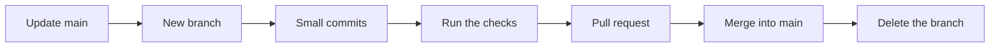

# How we work on this repository

Git keeps the history of a project. GitHub is the website that stores a copy of it online. These rules keep the project easy to follow, for people and for coding agents.

## The one idea that matters

**`main` is the working product.** Anyone who downloads this repository gets `main`, so it must always run, and its README must always be true. If a piece of work isn't in `main`, a visitor doesn't have it.

## The words

| Word | What it means |
|---|---|
| Repository (repo) | The project and its full history |
| Clone | Download your own full copy of a repo |
| Commit | One saved change, with a short ID such as `df5ea40` |
| Branch | A separate line of work that starts from `main`, so you can change things without breaking it |
| Push | Send your commits to GitHub |
| Pull | Bring GitHub's newest commits to your computer |
| Pull request (PR) | A request to merge a branch into `main`, where the change can be checked first |
| Merge | Bring a branch's work into `main` |
| Tag | A permanent name for one exact commit, such as `hackathon-submission` |
| Worktree | A second folder on your computer showing another branch, so two pieces of work can run side by side |
| Deploy | Put something on a server so that other people can reach it |
| `.env` | The local file holding your API keys. Git ignores it, and it must never be committed |

## Everyday steps

Each piece of work takes the same path, and most should take less than a day.



```bash
git switch main
```

```bash
git pull
```

```bash
git switch -c fix/what-this-does
```

Commit small and often, with one logical change per commit. Before opening a pull request, run:

```bash
uv run ruff check .
```

```bash
uv run pytest
```

Then:

```bash
git push -u origin fix/what-this-does
```

```bash
gh pr create --fill
```

Merge with a merge commit, never a squash, because reports cite commits by their ID. Delete the branch once it's merged, then start the next piece from an updated `main`.

## Where things go

Ask how long the thing should stay apart from `main`.

| The thing | Where it goes | Why |
|---|---|---|
| A feature or fix | A short-lived branch, merged quickly | It's meant to join `main` |
| Part of the product | A folder in `main` | People need it to run the product |
| Supporting evidence, such as `experiment/` | Its own folder in `main` | It's kept up to date and visible, but apart from the product |
| A variant that's meant to differ for good, such as `demo` | A long-lived branch that's never merged | It's meant to stay different. Keep these rare, because it stops getting `main`'s improvements |
| A different project with its own heavy files, such as the film | Its own repository | Every clone downloads everything in a repo's history |
| A moment you may want back, such as a submission | A tag | It can't drift or get lost |
| Keys and passwords | `.env` only | Anything pushed to a public repo should be treated as exposed for good |
| Large binaries such as videos | A GitHub Release or a video host | Once committed, they stay in the history and slow every clone |

**Folders separate things that should stay together. Branches separate things in time.** A branch is hard to see on GitHub, and it falls behind `main` from the day it's created.

## Rules that protect the results

- `errand/` is frozen at the tag `first-demo-agent-freeze`, apart from its rename. Don't change it unless the work is meant to change the agent. If it is, rerun the benchmark and move the tag.
- "Before" and "after" may differ only by the link line.
- Whoever writes benchmark queries sees only the facts, without placements. Whoever writes the resource never sees the queries.
- Benchmark runs spend real OpenRouter credit, so ask first. `--regrade` and `bench.summarize` are free.

## Working with coding agents

Several agents working at once is how a repo gets messy, so:

- **Give each session one job, and one branch.** Name the job at the start.
- **Finish before moving on.** A session ends with its work merged, or with a clear note on why it isn't.
- **Don't stack pull requests** unless you have to. If one depends on another, merge the first before starting the second.
- **Check `main`, not the running app.** "It works on my screen" can mean it's running from a branch that visitors don't have. Before calling something done, run it from a fresh clone of `main`.
