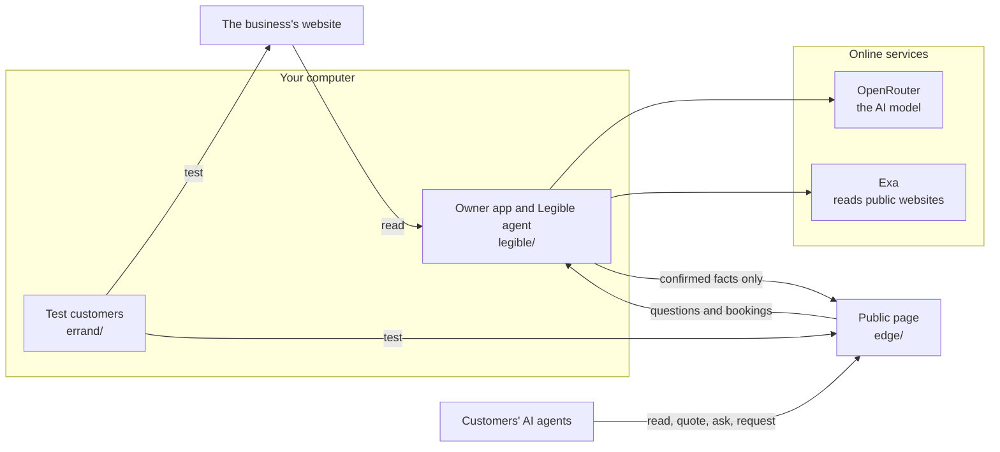

# Legible

**Legible prepares small businesses for AI agents.**

AI agents already shop for people, but they often can't finish the job on a small business's website. Prices sit in images, rules are buried, and the agent gives up or guesses.

Give Legible a website. It reads the site, works out what an agent couldn't, and asks the owner to fill the gaps. It then publishes a small page that the owner links from their site. Agents read the confirmed facts there, work out quotes and send booking requests. Only facts the owner has confirmed ever go public.

## Does it help?

We tested this on a fictional business with our own stand-in agent, once with the website alone and once with one added link to a page written for agents.

| On the 7 questions run on both versions | Website alone | With the link |
|---|---|---|
| Correct answers | 3 of 7 | **7 of 7** |
| Runs that needed a browser | 5 of 7 | 0 of 7 |
| Average time per run | 165 s | 32 s |
| Average cost per run | $0.263 | $0.071 |

This is an early signal, not a measured rate. The page in that test was written by hand, while a page generated by Legible scored 3 of 4 in a smaller test. Real agents such as Muse are untested. [The experiment](experiment/README.md) has the full results and their limits, and you can re-check them for free.

## How it works



- **The owner app** runs on your computer. It reads the site, builds a fact sheet, asks you what's missing and reviews what agents did.
- **The test customers** are AI agents that try real customer requests on your site, then on your page, so you can compare the two.
- **The public page** is built from the fact sheet and needs no AI to serve. It runs on your computer until you put it online.

The agent changes the fact sheet and never the page, so every part of the page stays consistent. Nothing an outside agent says can change the facts.

## Run it

This takes about 5 minutes to set up. These steps were tested on macOS.

### 1. Install what you need

- **[uv](https://docs.astral.sh/uv/getting-started/installation/)**, which runs the Python code and installs Python 3.12 and its dependencies.
- **[Node.js](https://nodejs.org)**, version 20 or newer, which runs the public page.

### 2. Download the code

```bash
git clone https://github.com/Jamerrred/Legible.git
```

```bash
cd Legible
```

```bash
uv sync
```

Test customers sometimes need a real browser, so install one:

```bash
uv run --with playwright playwright install chromium
```

### 3. Add your API keys

Make your settings file, which git ignores:

```bash
cp .env.example .env
```

Then open `.env` and fill in these two keys:

| Key | What it's for | Where to get it |
|---|---|---|
| `OPENROUTER_API_KEY` | The AI model behind every agent | [openrouter.ai/keys](https://openrouter.ai/keys) |
| `EXA_API_KEY` | Reads public websites and runs the test customers' web searches | [dashboard.exa.ai](https://dashboard.exa.ai) |

Leave the other settings as they are. `scripts/start.py` fills them in.

### 4. Start Legible

```bash
uv run python scripts/start.py
```

The first start takes about a minute. It opens the app at **http://127.0.0.1:8200**. Keep that terminal open while you use it, and press `Ctrl+C` to stop.

### 5. Try it

The **Next** card at the bottom of the sidebar always shows what to do now, so you can simply follow it. Real AI does the work, so each step spends a little credit.

1. **Websites: connect a website.** Paste an address and press the arrow. Use your own, or this fictional business, which has prices in images and missing rules on purpose:

   ```text
   https://sunrise-auto-detailers.jamerrred-audiobooks.workers.dev
   ```

   Leave "Also test it with customer agents" on to see the full flow. That usually takes 5 to 10 minutes and costs up to about $2.50. Turn it off for a quick try, which takes about a minute and costs a few cents.

2. **Simulations: see what stopped the agents.** Each test customer shows the question it was given, its answer, and where it got stuck. Under **What's missing**, answer each question in your own words, or press **This doesn't apply**.

3. **Resource: confirm the facts.** Check what Legible read from the site. Click any line or price to fix it, then press **Confirm and publish**. Nothing is public until you do.

4. **Simulations: test it again.** Press **Run the check again**. The same kind of customers now use your page, so you can compare the two scores.

5. **Websites: put the link on your site.** Copy your link. It's the one line a real business adds to its website, and **Check it's on your site** looks for it. It won't find it on the fictional business, because you can't edit that site.

6. **Inbox and Bookings: act like an agent.** Press **Open the page**, then use its **Ask** and **Request** pages. The question shows up in **Inbox** and the request in **Bookings**. Answer or accept them, then open the status link to see your reply.

7. **Resource: change something.** Type a change into the box at the bottom, such as `We're closed for the next 2 days`. Legible works out the exact change and asks you to confirm. A closure ends by itself when its dates pass, and **Undo last change** takes back the last edit.

The app has no spending limit of its own, so set a credit limit on your OpenRouter key if you want a hard stop.

### Connect accounts (optional)

To let owners connect accounts such as Google Calendar and Google Sheets through Composio, add `COMPOSIO_API_KEY` to `.env` and restart. Then go to **Websites** and press **Connect** beside an account. This code hasn't been run with a real key yet, so expect rough edges.

## See it without keys

The `demo` branch holds a scripted copy of the app that plays the same story back in about 3 minutes, with sample data, no API keys and no credit. It's the version our film was recorded from.

```bash
git switch demo
```

```bash
uv sync
```

```bash
uv run python scripts/start.py --demo
```

Open `http://127.0.0.1:8300`. Run `git switch main` to come back to the real app. If you've run the real app already, stop it first, because both use the same local page.

## What's in this repository

| Folder | What it is |
|---|---|
| [`legible/`](legible/) | The product: the owner app and the Legible agent |
| [`edge/`](edge/) | The public page, a Cloudflare Worker |
| [`errand/`](errand/) | The test customers: a general-purpose consumer agent that knows nothing about Legible |
| [`scripts/`](scripts/) | Starts the app |
| [`tests/`](tests/) | Automated checks |
| [`experiment/`](experiment/README.md) | The before-and-after test: its fictional business, questions, logs and reports |
| [`docs/`](docs/) | How we work, plus the original planning notes |

## Test it

These need no keys and cost nothing:

```bash
uv run pytest
```

```bash
uv run ruff check .
```

## If something goes wrong

| What you see | What to do |
|---|---|
| `Add OPENROUTER_API_KEY...` when starting | Fill in your keys in `.env`, then start again |
| `Another program is using port...` | Close the other program or your other copy of Legible, or use another port for the app: `LEGIBLE_PORT=8400 uv run python scripts/start.py` |
| The website shows "couldn't be read" | Check the address opens in a browser, then check your Exa key. Sites that block automated visitors can fail |
| A stage fails with an error from the model | Check your OpenRouter key and balance, then add the website again |
| A test customer says "Agent crashed" | The AI provider returned an error. It doesn't count against the business, so run the check again |
| You want to start over | Stop Legible and delete `legible/legible.db` |

## Limits

- **Real agents are untested.** Whether agents such as Muse follow the link is still an open question.
- **It's a prototype.** The app has no login, so keep it on your own computer.
- **The fictional business is fictional,** and any match with a real business's name is a coincidence.

## Learn more

- [The experiment and its results](experiment/README.md)
- [How the app was built and tested](experiment/reports/legible-mvp.md)
- [How we work on this repository](CONTRIBUTING.md)
- [The original planning notes](docs/planning/README.md)
