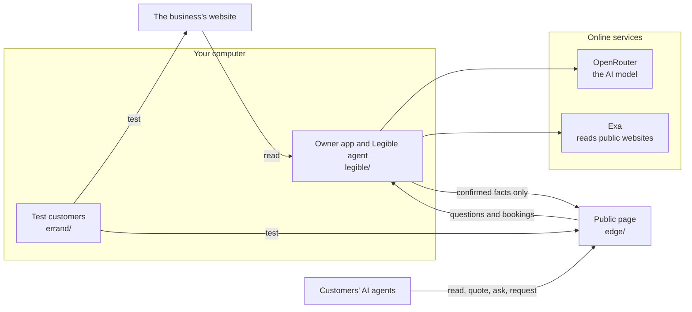

# Legible

**Legible is an agentic commerce platform, powered by Muse Spark, that gets small businesses ready for AI agents.** It turns a website built for people into a verified page that agents can read, price and act on.

AI agents like Muse and Instinct already shop for people, but they often can't finish the job on a small business's website. Reading the page is only the start. The agent has to turn a messy request into a correct, all-in answer, using rules that the site scatters across pages or never states:

- *"Inside and out on my Outback, with dog hair on the back seat, under $400 all in. Saturday or a weekday?"* The answer depends on the car's size class, an add-on, a Saturday fee, a travel zone and tax.
- *"Who can wash three work vans on a Saturday?"* A fleet discount applies, but fleet jobs only run Tuesday to Friday, and the site mentions neither.
- *"My kid was sick in the back seat. Can you clean it up?"* The business refuses biohazards, but its site never says so. Our test agent told the customer yes, for $344.

When a site leaves gaps like these, agents either give up or confidently make something up.

**See it:** [a page Legible generated](https://legible.jamerrred-audiobooks.workers.dev/b/sunrise-auto-detailers) for a fictional business, from [its website](https://sunrise-auto-detailers.jamerrred-audiobooks.workers.dev).

## What Legible does

A business owner gives Legible their website. Legible builds a structured record of the business, tests it with simulated customer agents, asks the owner to fill whatever stopped them, and publishes the result as a page any agent can use.

1. **Ingest.** Exa and our own breadth-first crawler read the site, and their results are merged so that one catches what the other misses. A vision pass transcribes facts trapped in images, such as price boards. Muse Spark then extracts a typed fact sheet of offerings, size variants, add-ons, fees, service zones, tax, policies and exclusions, each with its source URL and marked as a draft. Owners can also connect accounts such as Google Calendar and Sheets through Composio, though that path hasn't run with a real account yet.

2. **Simulate.** Legible writes realistic customer requests and runs each one through Errand, our consumer agent, in its own process. Errand is modelled on how Muse described its own process: search first, then read pages, and open a live browser only if it has to. It runs on a budget of 15 tool calls and two browser workers. Two code gates keep it honest: one sends back any claim marked as verified if its numbers never appeared in a tool result, and the other blocks any tool call carrying the customer's personal details until they approve.

3. **Find the gaps.** Runs that couldn't settle an answer are traced back to the facts that were missing. Each gap becomes one plain question for the owner, linked to the customer requests it would have unblocked. The owner answers in their own words, and Muse Spark turns the answer into typed operations on the fact sheet.

4. **Publish.** A filter strips anything unconfirmed, so a draft never leaves the owner's machine. A Cloudflare Worker backed by D1 serves the rest as HTML and markdown, with no model in the request path. Agents get a deterministic `/quote` engine, also available as JSON, that handles size variants, add-ons, fees, zones, tax and closures without asking for personal details, plus `/request` and `/ask` endpoints. Facts the owner hasn't stated are published as explicit unknowns, so agents don't fill the silence with a guess.

5. **Embed.** The owner adds one link line to their website. In [our benchmark](#benchmark-can-an-agent-finish-the-job), that one line took an unmodified agent from 3 of 7 correct answers to 7 of 7, about 5 times faster and 3.7 times cheaper, using a hand-written page of the same kind.

6. **Keep it true.** Every read, quote, question, booking and dead end is logged as an event and pulled into the owner's agent inbox. A periodic review turns failed quotes and dead ends into new questions, and reports unmet demand, such as "3 agents asked for ceramic coating". The owner can change anything in plain language: "We're closed for the next 2 days" becomes a proposed change with absolute dates, goes live once confirmed, and expires by itself. Every change creates a new version of the record, with one-step undo.

The Legible agent edits the fact sheet and never the page, so it can't break the page. Text from outside agents is treated as data: it can prompt a question to the owner, but it can't change a fact.

## Benchmark: can an agent finish the job?

We ran a controlled before-and-after test to see whether one link to an agent-ready page changes what an unmodified agent can do.

- **The business:** Sunrise Auto Detailers, a fictional mobile detailer defined by 75 facts. Its three-page website leaves out 37 of them, hides 34 in places such as image price boards, FAQ answers and a lead form, and states 4 plainly.
- **Three versions:** the website alone, the same website plus one link line (checked by diffing every page), and a control page with the same facts in plain text, which shows the best the agent can do.
- **The agent:** Errand on Muse Spark 1.3, frozen at a git tag before any run. It knows nothing about Legible, and the page isn't in its search index, so the link is the only way in.
- **The questions:** 12 customer requests, written from the facts alone by a separate agent that never saw the site or the page.
- **Grading:** done in code against each question's expected answer. Every run's full log is saved, so anyone can regrade the results for free.

### Results

| On the 7 questions run on all three versions | Website alone | With the link | Control page |
|---|---|---|---|
| Correct answers | 3 of 7 | **7 of 7** | 7 of 7 |
| Runs that needed a browser | 5 of 7 | **0 of 7** | 0 of 7 |
| Browser worker calls | 8 | **0** | 0 |
| Average time per run | 165 s | **32 s** | 29 s |
| Average cost per run | $0.263 | **$0.071** | $0.041 |

Errand found and used the page in 6 of those 7 runs without being told it exists. Across all 12 questions, it got 12 of 12 right with the link. The other 5 never ran on the website alone, because our credit ran out.

### What we asked

These test far more than whether an agent can read a price.

| Testing | The customer's request, shortened | What a correct answer takes | Website alone | With the link |
|---|---|---|---|---|
| Total under a cap | Inside and out on an Outback with dog hair, under $400 all in. Saturday or a weekday? | Size class, add-on, Saturday fee, tax and travel zone: $422.38 on Saturday misses the cap, and $395.22 on a weekday fits | No answer | Correct |
| Messy description | A muddy F-250 interior, with the nearest outlet 150 feet away. What's the whole cost? | Map everyday words to a package, surcharge and shampoo, and see that the outlet is too far, so a generator fee applies: $628.76 | No total | Correct |
| Open market, day rule | Who can wash three Transit vans on a Saturday, all in? | Find the business through search, apply a 10% fleet discount: $407.67, but only Tuesday to Friday | Wrong | Correct |
| Not offered | Clean up dried vomit in a CR-V | Say no, because the business refuses biohazards | Wrong | Correct |
| Not offered | Ceramic coating on a new Model Y | Say no, and point to the longest-lasting protection it does sell | Correct | Correct |
| Prerequisite | Interior clean in an underground garage with no outlet. Can they bring a generator? | Say no: the job needs an outlet, and the generator can't run underground. Permission from the building is also on the customer | Correct | Correct |
| Policy | Cancel 36 hours out after paying a deposit. What comes back, and can I move it instead? | $75 back, or move it for free, since it's the first change | Correct | Correct |
| Unknown | Will the top package's polish remove a deep key scratch? | Refuse to give a yes or no, because only an inspection can settle it | Not run | Correct |
| Unknown | What would a Cybertruck with polished stainless panels cost? | Refuse to quote, because the owner hasn't decided | Not run | Correct |
| Wrong premise | A directory says $129 and open Sundays. Can you confirm? | Reject the listing: it's really $237.89 all in, and closed on Sundays | Not run | Correct |
| Taking action | Request the next evening wash, but check with me first | Work out $118.40, get approval, then send it, and explain that the request doesn't hold the slot | Not run | Correct |
| Availability | What's the soonest date and arrival window for a Forester? | Find the earliest open window at least 24 hours away, outside closures | Not run | Correct |

### Three answers that changed

**The job it should have refused.** With the website alone, after 147 s and $0.275, Errand told the customer "Yes" and quoted $344. With the link, after 27 s and $0.045: "No — Sunrise Auto Detailers says it will not clean this job up, even though you are in its service area."

**The Saturday that can't happen.** With the website alone, Errand quoted three vans at $417 and said the business works Saturdays. With the link, it worked out $407.67 through `/quote` and caught the rule: "3 vans together counts as a fleet job, and fleet jobs run Tuesday to Friday only."

**The budget decision.** With the website alone, two browser workers used about 5 minutes without finishing, and the run hit its 6-minute limit with no answer. With the link, Errand settled it in 42 s for $0.076: Saturday is $22.38 over the cap, and a weekday fits with $4.78 to spare.

### What we learned

- **Agents read silence as yes.** Saying what a business doesn't do matters as much as listing prices.
- **Missing facts were the main limit, more than parsing.** The browser worker could read the image price board, so that cost time and money without changing the answers. With the link, Errand came close to the control page's best case.
- **An unmodified agent will follow one link.** It reached the page in 11 of 12 runs across all the questions, and the twelfth didn't need it.

### How far to trust this

This is an early signal, not a measured rate.

- **It's small:** one run per question. The 7 compared questions are simply the ones that ran before the credit ran out.
- **It's partly by design:** the website leaves out 37 of its 75 facts on purpose, so better answers are expected.
- **The page was hand-written as an answer key.** A page generated end to end by Legible scored 3 of 4 in a smaller test, after 1 of 4 on its first run, and it still got the vomit question wrong.
- **Errand isn't Muse.** It ran locally, its instructions tell it to follow useful links on a business's own site, and real Muse hasn't been tested yet.

[The experiment](experiment/README.md) has every answer, the method and the full [report](experiment/reports/first-demo-benchmark.md), and you can [re-check the results for free](experiment/README.md#check-the-saved-results-free-no-keys).

## How it works



- **The owner app** runs on your computer. It reads the site, builds a fact sheet, asks you what's missing and reviews what agents did.
- **The test customers** are AI agents that try real customer requests on your site, then on your page, so you can compare the two.
- **The public page** is built from the fact sheet and needs no AI to serve. It runs on your computer until you [put it online](#put-your-page-online).

The agent changes the fact sheet and never the page, so every part of the page stays consistent. Nothing an outside agent says can change the facts.

## Run it

This takes about 5 minutes to set up. These steps were tested on macOS.

### 1. Install what you need

- **[uv](https://docs.astral.sh/uv/getting-started/installation/)**, which runs the Python code and installs Python 3.12 and its dependencies.
- **[Node.js](https://nodejs.org)**, version 20 or newer, which runs the public page.

### 2. Download the code

```bash
git clone https://github.com/Jamerrred/Legible.git
```

```bash
cd Legible
```

```bash
uv sync
```

Test customers sometimes need a real browser, so install one:

```bash
uv run --with playwright playwright install chromium
```

### 3. Add your API keys

Make your settings file, which git ignores:

```bash
cp .env.example .env
```

Then open `.env` and fill in these two keys:

| Key | What it's for | Where to get it |
|---|---|---|
| `OPENROUTER_API_KEY` | The AI model behind every agent | [openrouter.ai/keys](https://openrouter.ai/keys) |
| `EXA_API_KEY` | Reads public websites and runs the test customers' web searches | [dashboard.exa.ai](https://dashboard.exa.ai) |

Leave the other settings as they are. `scripts/start.py` fills them in.

### 4. Start Legible

```bash
uv run python scripts/start.py
```

The first start takes about a minute. It opens the app at **http://127.0.0.1:8200**. Keep that terminal open while you use it, and press `Ctrl+C` to stop.

### 5. Try it

The **Next** card at the bottom of the sidebar always shows what to do now, so you can simply follow it. Real AI does the work, so each step spends a little credit.

1. **Websites: connect a website.** Paste an address and press the arrow. Use your own, or this fictional business, which has prices in images and missing rules on purpose:

   ```text
   https://sunrise-auto-detailers.jamerrred-audiobooks.workers.dev
   ```

   Leave "Also test it with customer agents" on to see the full flow. That usually takes 5 to 10 minutes and costs up to about $2.50. Turn it off for a quick try, which takes about a minute and costs a few cents.

2. **Simulations: see what stopped the agents.** Each test customer shows the question it was given, its answer, and where it got stuck. Under **What's missing**, answer each question in your own words, or press **This doesn't apply**.

3. **Resource: confirm the facts.** Check what Legible read from the site. Click any line or price to fix it, then press **Confirm and publish**. Nothing is public until you do.

4. **Simulations: test it again.** Press **Run the check again**. The same kind of customers now use your page, so you can compare the two scores.

5. **Websites: put the link on your site.** Copy your link. It's the one line a real business adds to its website, and **Check it's on your site** looks for it. It won't find it on the fictional business, because you can't edit that site.

6. **Inbox and Bookings: act like an agent.** Press **Open the page**, then use its **Ask** and **Request** pages. The question shows up in **Inbox** and the request in **Bookings**. Answer or accept them, then open the status link to see your reply.

7. **Resource: change something.** Type a change into the box at the bottom, such as `We're closed for the next 2 days`. Legible works out the exact change and asks you to confirm. A closure ends by itself when its dates pass, and **Undo last change** takes back the last edit.

The app has no spending limit of its own, so set a credit limit on your OpenRouter key if you want a hard stop.

### Connect accounts (optional)

To let owners connect accounts such as Google Calendar and Google Sheets through Composio, add `COMPOSIO_API_KEY` to `.env` and restart. Then go to **Websites** and press **Connect** beside an account. This code hasn't been run with a real key yet, so expect rough edges.

## Put your page online

Until now, your page has only been reachable from your own computer. To let real agents reach it, deploy it to your own Cloudflare account. A free account is enough.

```bash
uv run python scripts/deploy.py
```

This signs you in, creates the database, deploys the page and points Legible at its live address. Anything you've already published moves across. Then restart Legible, and your link becomes a real public address that you can add to your website.

Only the public page goes online. The owner app stays on your computer, because it has no login and anyone who reached it could spend your AI credit. The page keeps working when your computer is off. New questions and bookings wait there until you next open the app, and the periodic review of what agents did only runs while the app is open.

Pages tell search engines not to index them for now, so agents reach yours through the link on your site. To go back to a local page, set `LEGIBLE_EDGE_URL=http://127.0.0.1:8787` in `.env`.

## See it without keys

The `demo` branch holds a scripted copy of the app that plays the same story back in about 3 minutes, with sample data, no API keys and no credit. It's the version our film was recorded from.

```bash
git switch demo
```

```bash
uv sync
```

```bash
uv run python scripts/start.py --demo
```

Open `http://127.0.0.1:8300`. Run `git switch main` to come back to the real app. If you've run the real app already, stop it first, because both use the same local page.

## What's in this repository

| Folder | What it is |
|---|---|
| [`legible/`](legible/) | The product: the owner app and the Legible agent |
| [`edge/`](edge/) | The public page, a Cloudflare Worker |
| [`errand/`](errand/) | The test customers: a general-purpose consumer agent that knows nothing about Legible |
| [`scripts/`](scripts/) | Starts the app, and deploys the public page |
| [`tests/`](tests/) | Automated checks |
| [`experiment/`](experiment/README.md) | The before-and-after test: its fictional business, questions, logs and reports |
| [`docs/`](docs/) | How we work, plus the original planning notes |

## Test it

These need no keys and cost nothing:

```bash
uv run pytest
```

```bash
uv run ruff check .
```

## If something goes wrong

| What you see | What to do |
|---|---|
| `Add OPENROUTER_API_KEY...` when starting | Fill in your keys in `.env`, then start again |
| `Another program is using port...` | Close the other program or your other copy of Legible, or use another port for the app: `LEGIBLE_PORT=8400 uv run python scripts/start.py` |
| The website shows "couldn't be read" | Check the address opens in a browser, then check your Exa key. Sites that block automated visitors can fail |
| A stage fails with an error from the model | Check your OpenRouter key and balance, then add the website again |
| A test customer says "Agent crashed" | The AI provider returned an error. It doesn't count against the business, so run the check again |
| You want to start over | Stop Legible and delete `legible/legible.db` |

## Limits

- **Real agents are untested.** Whether agents such as Muse follow the link is still an open question.
- **It's a prototype.** The app has no login, so keep it on your own computer.
- **The fictional business is fictional,** and any match with a real business's name is a coincidence.

## Learn more

- [The experiment and its results](experiment/README.md)
- [How the app was built and tested](experiment/reports/legible-mvp.md)
- [How we work on this repository](CONTRIBUTING.md)
- [The original planning notes](docs/planning/README.md)
