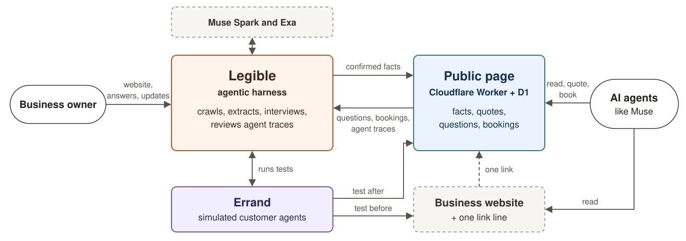
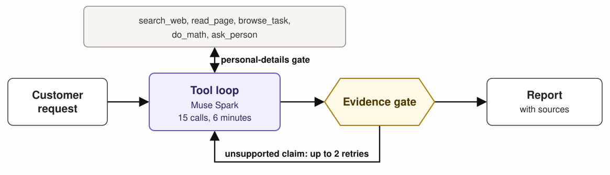

# Legible

**Legible is an agentic harness, powered by Muse Spark, that lets AI agents like Muse do business with small businesses.** It reads the business's website and connected accounts, runs simulated customer agents against them, and interviews the owner about whatever stopped those agents. It then publishes a verified page, which the owner embeds as a link on their website, social media or storefront. When a consumer agent like Muse arrives, it can use that page to answer the customer's questions, work out an all-in price and send a booking request.

<a href="https://www.youtube.com/watch?v=BCvsijSwoW0"></a>

**[Watch the 3-minute film](https://www.youtube.com/watch?v=BCvsijSwoW0)**

AI agents like Muse and Instinct already shop for people, but they often can't finish the job on a small business's website. Reading the page is only the start. The agent has to turn a messy request into a correct, all-in answer, using rules that the site scatters across pages or never states:

- *"Inside and out on my Outback, with dog hair on the back seat, under $400 all in. Saturday or a weekday?"* The answer depends on the car's size class, an add-on, a Saturday fee, a travel zone and tax.
- *"Who can wash three work vans on a Saturday?"* A fleet discount applies, but fleet jobs only run Tuesday to Friday, and the site mentions neither.
- *"My kid was sick in the back seat. Can you clean it up?"* The business refuses biohazards, but its site never says so. Our test agent told the customer yes, for $344.

When a site leaves gaps like these, agents either give up or confidently make something up.

**See it:** [a page Legible generated](https://legible.jamerrred-audiobooks.workers.dev/b/sunrise-auto-detailers) for a fictional business, from [its website](https://sunrise-auto-detailers.jamerrred-audiobooks.workers.dev).

## What Legible does

A business owner gives Legible a website and other resources connected to their business. Legible builds a structured record of the business, tests it with simulated customer agents, asks the owner to fill whatever stopped them, and publishes the result as a page any agent can use. It then keeps that page accurate: an agent inbox collects what outside agents ask and request, the traces they leave feed back into new questions, and the owner can update the page at any time in plain language.

1. **Ingest.** Exa and our own breadth-first crawler read the site, and their results are merged so that one catches what the other misses. A vision pass transcribes facts trapped in images, such as price boards. Muse Spark then extracts a typed fact sheet of offerings, size variants, add-ons, fees, service zones, tax, policies and exclusions, each with its source URL and marked as a draft. Owners can also connect accounts such as Google Calendar and Sheets through Composio, though that path hasn't run with a real account yet.

2. **Simulate.** Legible writes realistic customer requests and runs each one through [Errand](#errand-the-consumer-agent), our consumer agent, in its own process. Errand is modelled on how Muse described its own process: search first, then read pages, and open a live browser only if it has to.

3. **Find the gaps.** Runs that couldn't settle an answer are traced back to the facts that were missing. Each gap becomes one plain question for the owner, linked to the customer requests it would have unblocked. The owner answers in their own words, and Muse Spark turns the answer into typed operations on the fact sheet.

4. **Publish.** A filter strips anything unconfirmed, so a draft never leaves the harness. A Cloudflare Worker backed by D1 serves the rest as HTML and markdown, with no model in the request path. Agents get a deterministic `/quote` engine, also available as JSON, that handles size variants, add-ons, fees, zones, tax and closures without asking for personal details, plus `/request` and `/ask` endpoints. Facts the owner hasn't stated are published as explicit unknowns, so agents don't fill the silence with a guess. Rechecks run the same requests against a private preview of the page, so the before and after scores can be compared.

5. **Embed.** The owner adds one link line to their website, social media or storefront. In [our benchmark](#benchmark-can-an-agent-finish-the-job), that one line took an agent from 3 of 7 correct answers to 7 of 7, about 5 times faster and 3.7 times cheaper, using a hand-written page of the same kind.

6. **Run the agent inbox.** Questions and booking requests from outside agents reach the owner immediately. The owner's reply appears on a public status page that the agent can check.

7. **Learn from agent traces.** Every page read, quote, question, booking and dead end leaves a trace, which feeds an analytics view of which agents came, where they got stuck and what they wanted. A review every 6 hours turns failed quotes and dead ends into new questions for the owner, and reports unmet demand, such as "3 agents asked for ceramic coating".

8. **Update in plain language.** "We're closed for the next 2 days" becomes a proposed change with absolute dates, goes live once the owner confirms it, and expires by itself. Every change creates a new version of the record, with one-step undo.

## Benchmark: can an agent finish the job?

We ran a controlled before-and-after test to see whether an agent-ready page, which the business owner embeds in their website or storefront as one link, changes what an agent like Muse can do. We simulated that agent with [Errand](#errand-the-consumer-agent), a Muse-like agent we built.

- **The business:** Sunrise Auto Detailers, a fictional mobile detailer defined by 75 facts. Its three-page website leaves out 37 of them, hides 34 in places such as image price boards, FAQ answers and a lead form, and states 4 plainly.
- **Three versions:** the website alone, the same website plus one link line (checked by diffing every page), and a control page with the same facts in plain text, which shows the best the agent can do.
- **The agent:** Errand on Muse Spark 1.3, frozen at a git tag before any run. It knows nothing about Legible, and the page isn't in its search index, so the link is the only way in.
- **The questions:** 12 customer requests, written from the facts alone by a separate agent that never saw the site or the page.
- **Grading:** done in code against each question's expected answer. Every run's full log is saved, so anyone can regrade the results for free.

### Results

We graded 31 runs. The website-alone version stopped at 7 questions when our API credit ran out, so the fair comparison is on those 7.

| | Website alone | With the link | Control page |
|---|---|---|---|
| Correct, on every question run | 3 of 7 | **12 of 12** | 11 of 12 |
| Correct, on the same 7 questions | 3 of 7 | **7 of 7** | 7 of 7 |
| Runs that needed a browser, same 7 | 5 of 7 | **0 of 7** | 0 of 7 |
| Browser worker calls, same 7 | 8 | **0** | 0 |
| Average time per run, same 7 | 165 s | **32 s** | 29 s |
| Average cost per run, same 7 | $0.263 | **$0.071** | $0.041 |

Errand found and used the page in 6 of those 7 runs, and 11 of all 12, without being told it exists. Across the 12 runs with the link, it read the page's facts to answer the customer in 11, called `/quote` to work out prices in 9, and sent a booking request in the one question that asked for it, after getting the customer's approval.

### What we asked

These test far more than whether an agent can read a price.

| Testing | The customer's request, shortened | What a correct answer takes | Website alone | With the link |
|---|---|---|---|---|
| Total under a cap | Inside and out on an Outback with dog hair, under $400 all in. Saturday or a weekday? | Size class, add-on, Saturday fee, tax and travel zone: $422.38 on Saturday misses the cap, and $395.22 on a weekday fits | No answer | Correct |
| Messy description | A muddy F-250 interior, with the nearest outlet 150 feet away. What's the whole cost? | Map everyday words to a package, surcharge and shampoo, and see that the outlet is too far, so a generator fee applies: $628.76 | No total | Correct |
| Open market, day rule | Who can wash three Transit vans on a Saturday, all in? | Find the business through search, apply a 10% fleet discount: $407.67, but only Tuesday to Friday | Wrong | Correct |
| Not offered | Clean up dried vomit in a CR-V | Say no, because the business refuses biohazards | Wrong | Correct |
| Not offered | Ceramic coating on a new Model Y | Say no, and point to the longest-lasting protection it does sell | Correct | Correct |
| Prerequisite | Interior clean in an underground garage with no outlet. Can they bring a generator? | Say no: the job needs an outlet, and the generator can't run underground. Permission from the building is also on the customer | Correct | Correct |
| Policy | Cancel 36 hours out after paying a deposit. What comes back, and can I move it instead? | $75 back, or move it for free, since it's the first change | Correct | Correct |
| Unknown | Will the top package's polish remove a deep key scratch? | Refuse to give a yes or no, because only an inspection can settle it | Not run | Correct |
| Unknown | What would a Cybertruck with polished stainless panels cost? | Refuse to quote, because the owner hasn't decided | Not run | Correct |
| Wrong premise | A directory says $129 and open Sundays. Can you confirm? | Reject the listing: it's really $237.89 all in, and closed on Sundays | Not run | Correct |
| Taking action | Request the next evening wash, but check with me first | Work out $118.40, get approval, then send it, and explain that the request doesn't hold the slot | Not run | Correct |
| Availability | What's the soonest date and arrival window for a Forester? | Find the earliest open window at least 24 hours away, outside closures | Not run | Correct |

### Three answers that changed

**The job it should have refused.** With the website alone, after 147 s and $0.275, Errand told the customer "Yes" and quoted $344. With the link, after 27 s and $0.045: "No — Sunrise Auto Detailers says it will not clean this job up, even though you are in its service area."

**The Saturday that can't happen.** With the website alone, Errand quoted three vans at $417 and said the business works Saturdays. With the link, it worked out $407.67 through `/quote` and caught the rule: "3 vans together counts as a fleet job, and fleet jobs run Tuesday to Friday only."

**The budget decision.** With the website alone, two browser workers used about 5 minutes without finishing, and the run hit its 6-minute limit with no answer. With the link, Errand settled it in 42 s for $0.076: Saturday is $22.38 over the cap, and a weekday fits with $4.78 to spare.

### What we learned

- **Agents read silence as yes.** Saying what a business doesn't do matters as much as listing prices.
- **Missing facts were the main limit, more than parsing.** The browser worker could read the image price board, so that cost time and money without changing the answers. With the link, Errand came close to the control page's best case.
- **An agent that's never heard of Legible will follow one link.** It reached the page in 11 of 12 runs, and the twelfth didn't need it.

### How far to trust this

This is an early signal, not a measured rate.

- **It's small:** one run per question. The 7 compared questions are simply the ones that ran before the credit ran out.
- **It's partly by design:** the website leaves out 37 of its 75 facts on purpose, so better answers are expected.
- **The page was hand-written as an answer key.** A page generated end to end by Legible scored 3 of 4 in a smaller test, after 1 of 4 on its first run, and it still got the vomit question wrong.
- **Errand isn't Muse.** It ran locally, its instructions tell it to follow useful links on a business's own site, and real Muse hasn't been tested yet.

[The experiment](experiment/README.md) has every answer, the method and the full [report](experiment/reports/first-demo-benchmark.md), and you can [re-check the results for free](experiment/README.md#check-the-saved-results-free-no-keys).

## Architecture

Legible has two parts. The **harness** is a self-hosted FastAPI service, where the agents run and the owner works. The **public page** is a Cloudflare Worker backed by D1, which serves outside agents without calling a model. The two talk over one authenticated admin API.

<picture>
  <source media="(prefers-color-scheme: dark)" srcset="docs/architecture/system-overview-dark.svg">
  
</picture>

| Part | Code | What it does |
|---|---|---|
| Harness | [`legible/`](legible/) | Runs onboarding, simulations and reviews as background jobs. Each judgement is one structured Muse Spark call, and the typed fact sheet in SQLite gets a new version with every change |
| Errand | [`errand/`](errand/) | Plays each test customer, one process per run |
| Public page | [`edge/`](edge/) | Serves pages as HTML and markdown, computes quotes and logs every interaction |

### Errand: the consumer agent

Errand is a general-purpose agent that acts for a person who wants something from a business. It holds nothing specific to any business and knows nothing about Legible, which is what makes it a fair test. It has been frozen since the tag `first-demo-agent-freeze`, apart from its rename.

<picture>
  <source media="(prefers-color-scheme: dark)" srcset="docs/architecture/errand-dark.svg">
  
</picture>

- **Evidence gate.** Each claim is labelled `verified_at_source`, `listed_unverified` or `unknown`. Code sends back a verified claim if it has no source, or if its numbers never appeared in a tool result.
- **Personal-details gate.** Code blocks any search, read or browser call that carries the customer's details until they've approved it through `ask_person`.

### Design rules

- **One gate to public.** `public_view()` serves confirmed items only, so a draft can't reach the public page.
- **Agents write data, not pages.** The model emits typed operations on the fact sheet, and the Worker renders every page from that record. An agent can't break the page or make its parts disagree.
- **Outside text is data.** Every model call carries a rule that text from websites, agents and customers is never an instruction. Outside agents can prompt a question to the owner, but they can't change a fact.
- **No model on the public page.** Serving a page or a quote costs no model credit and leaves no prompt to inject.
- **Least privilege.** Publishing requires a bearer token held by the harness, and API keys for AI services never leave it.
- **Closed to other websites.** The harness refuses writes from other sites and requests to unknown hostnames, so a page open in the owner's browser can't drive it or spend their credit.

## Quickstart

Install [uv](https://docs.astral.sh/uv/getting-started/installation/) and [Node.js](https://nodejs.org) 20 or newer, then:

```bash
git clone https://github.com/Jamerrred/Legible.git
cd Legible
uv sync
uv run --with playwright playwright install chromium
cp .env.example .env
```

Add two keys to `.env`. `scripts/start.py` fills in the other settings.

| Key | Used for | Get it from |
|---|---|---|
| `OPENROUTER_API_KEY` | Muse Spark, behind every agent | [openrouter.ai/keys](https://openrouter.ai/keys) |
| `EXA_API_KEY` | Crawling public sites and Errand's web searches | [dashboard.exa.ai](https://dashboard.exa.ai) |

Then start the stack:

```bash
uv run python scripts/start.py
```

This runs the harness at `http://127.0.0.1:8200`, with API docs at `/docs`. Until you [deploy the public page](#deployment), it also runs the Worker locally at `http://127.0.0.1:8787`, using a local D1. No Cloudflare account is needed for this.

To try it, onboard this fictional business, which has prices in images and missing rules on purpose:

```text
https://sunrise-auto-detailers.jamerrred-audiobooks.workers.dev
```

**Cost:** a full onboarding with 5 simulated customers takes 5 to 10 minutes and costs up to about $2.50 in OpenRouter credit. Without the simulation, it takes about a minute and costs a few cents. The app has no spending limit of its own, so set one on your OpenRouter key.

To connect accounts such as Google Calendar and Sheets through Composio, add `COMPOSIO_API_KEY` to `.env` and restart. This path hasn't run with a real key yet.

### Try it without keys

The `demo` branch holds a scripted copy of the app, which replays the same flow on sample data with no keys or credit. Our film was recorded from it.

```bash
git switch demo
uv sync
uv run python scripts/start.py --demo
```

It runs at `http://127.0.0.1:8300`.

## Deployment

Deploy the public page to your own Cloudflare account, so real agents can reach it. A free account is enough.

```bash
uv run python scripts/deploy.py
```

The script signs in with Wrangler, provisions a D1 database, applies the schema, deploys the Worker, sets its `ADMIN_TOKEN` secret and points `LEGIBLE_EDGE_URL` at the live address. Anything already published moves across. Restart the harness afterwards, and each website's link becomes a public address.

The public page keeps serving when the harness is offline. New questions and bookings wait in D1 until the harness next pulls them, and the 6-hour review only runs while it's up.

**Run the harness on a private host.** It has no authentication yet, and it holds your API keys, so don't expose it to the internet. It only answers on `127.0.0.1` and `localhost`, so on another machine, add its hostname to `LEGIBLE_ALLOWED_HOSTS`. Published pages also send `X-Robots-Tag: noindex` for now, so agents reach them through the link on the business's site.

## Repository structure

```text
legible/              Harness
  api.py              REST API for the owner console
  work.py             Jobs: onboarding, simulations, publishing, periodic review
  brain.py            Every model judgement, one structured call each
  crawl.py            Exa and breadth-first crawling, image fetching
  record.py           Fact sheet schema, typed operations, confirmed-only public view
  store.py            SQLite: versions, inbox, simulations, events
  edge.py             Client for the Worker's admin API
  model.py            Structured model calls through OpenRouter
  connectors.py       Composio account connections
  web/                Owner console
edge/                 Public page
  src/index.js        Worker: pages, markdown, quote engine, forms, admin API
  schema.sql          D1 schema
errand/               Consumer agent
  loop.py             Orchestrator tool loop
  tools.py            Tools, search backends and the evidence gate
  worker.py           browser-use worker
  person.py           Customer profile and the personal-details gate
  llm.py              OpenRouter client
experiment/           Benchmark: sample business, questions, grader, run logs and reports
scripts/              start.py runs the stack, deploy.py deploys the public page
tests/                Test suite
docs/architecture/    The diagrams
docs/planning/        Original research and design notes
```

## Reproducing the benchmark

Every run's log is in this repository. Regrading the saved runs is free and needs no keys:

```bash
cd experiment
uv run python -m bench.run_benchmark --variant before --name first-demo --regrade
uv run python -m bench.run_benchmark --variant after --name first-demo --regrade
uv run python -m bench.run_benchmark --variant control --name first-demo --regrade
uv run python -m bench.summarize --name first-demo
```

To rerun it from scratch for about $6 of OpenRouter credit, follow [the experiment's guide](experiment/README.md#run-it-again-spends-openrouter-credit).

## Tests

These need no keys and cost nothing:

```bash
uv run pytest
uv run ruff check .
```

## Learn more

- [The experiment and its results](experiment/README.md)
- [How the app was built and tested](experiment/reports/legible-mvp.md)
- [How we work on this repository](CONTRIBUTING.md)
- [The original planning notes](docs/planning/README.md)
